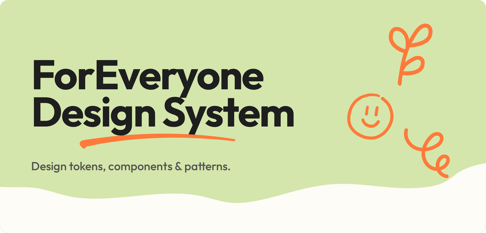

[](https://design.foreveryone.berlin)

# ForEveryone Design System

The shared design system for ForEveryone, an open and inclusive community space in Berlin. It keeps the brand consistent across the WordPress [site](https://foreveryone.berlin/), the Next.js [app](https://app.foreveryone.berlin), and internal work in Claude Design.

This repository holds the design tokens, reusable CSS, component contracts, and agent skills.

Explore the live system: **[https://design.foreveryone.berlin](https://design.foreveryone.berlin)**.

| Task                          | Start here                                                                                                                                                                       |
| ----------------------------- | -------------------------------------------------------------------------------------------------------------------------------------------------------------------------------- |
| Explore the visual system     | [Foundations](https://design.foreveryone.berlin/foundations), [components](https://design.foreveryone.berlin/components), [patterns](https://design.foreveryone.berlin/patterns) |
| Implement UI                  | [Use the system](#use-the-system), then [component contracts](spec/components/README.md)                                                                                         |
| Work with Figma               | [Style Guide](https://www.figma.com/design/U6oj7xy85cfOQV1o0XtTKC?node-id=938-7171) (requires file access), [sync guide](figma/sync-guide.md)                                    |
| Connect a platform            | [Integration guides](integrations/README.md), including WordPress + Elementor                                                                                                    |
| Install consumer agent skills | [Skills and installer](docs/agent-skills.md)                                                                                                                                     |
| Contribute                    | [Contributing guide](docs/contributing.md)                                                                                                                                       |

## Use the system

Use the shared CSS with plain HTML, React/Next.js, or another framework. For agent-led work, including Claude Design, start with the [design-system skill](skills/fe-design-system/SKILL.md). The files are consumed from this repository, not a published npm package. Design materials use CC BY-NC 4.0; see [License](#license) before reuse.

Clone the repository, then copy its `css/` directory into your project's public assets, preserving the files together:

```bash
git clone https://github.com/Foreveryone-berlin/design-system.git
cd design-system
```

For example, with that directory served at `/css/`, load the layers in this order:

```html
<link rel="stylesheet" href="/css/custom-properties.css" />
<link rel="stylesheet" href="/css/base.css" />
<link rel="stylesheet" href="/css/typography.css" />
<link rel="stylesheet" href="/css/utilities.css" />

<button type="button" class="fe-btn-primary">Book workshop</button>
```

`base.css` includes global resets and body styles. The host must load Filson Pro as `FilsonPro` to match the typography tokens; CSS alone does not load the font.

The `fe-*` classes provide styles. Interactive components also need the markup and behaviour described in their [contracts](spec/components/README.md). The [Next.js preview app](prototype/README.md) has working examples; platform-specific setup lives in [integrations](integrations/README.md).

## Run the preview

Requires **Node 24.x**, matching [`.nvmrc`](.nvmrc). From the cloned repository root:

```bash
node scripts/build-css.js
cd prototype
npm install
npm run dev
```

Open [http://localhost:3000](http://localhost:3000). The preview uses Next.js 16 and TypeScript and is hosted on Vercel.

## Sources and structure

Figma governs visual decisions; this repository governs implementation. Approved changes must be reflected in both. See the [brand authority matrix](docs/brand-book-references.md).

| Source                           | Purpose                                                                     |
| -------------------------------- | --------------------------------------------------------------------------- |
| [`tokens/`](tokens/)             | W3C DTCG JSON tokens: colours, typography, spacing, radius, shadows, motion |
| [`css/`](css/)                   | Generated custom properties and authored, variable-driven CSS layers        |
| [`spec/`](spec/)                 | Component contracts, design principles, machine-readable token spec         |
| [`prototype/`](prototype/)       | Working Next.js reference and documentation app                             |
| [`integrations/`](integrations/) | Host-specific setup and mappings                                            |
| [`skills/`](skills/)             | Consumer agent skill sources and shared conventions                         |

Token JSON → `node scripts/build-css.js` → [`css/custom-properties.css`](css/custom-properties.css) → authored CSS and consumers. Never hand-edit generated custom properties. Root `npm run build` also generates the token spec and consumer skills.

## Verification

[CI](.github/workflows/ci.yml) is configured to check:

- Token structure, generated CSS, SVG assets, and UI glyphs.
- Drift between sources and generated CSS, token specs, and skills.
- Production builds of the Next.js prototype.
- Playwright interaction tests and axe accessibility scans in Chromium.

Automated scans are not a complete accessibility assessment. Known gaps, documentation-specimen exclusions, and manual checks are recorded in the [accessibility register](docs/a11y-conformance.md) and [validation guide](docs/validation.md). Consuming sites follow the [integration checklist](docs/integration-checklist.md).

## Contributing and releases

[Contributing](docs/contributing.md) covers setup, token changes, and pull requests. Branch from `develop`; `main` carries production releases. Changes to tokens or shared CSS require a [changelog](CHANGELOG.md) entry and regenerated output. [Release workflow](docs/skills/release.md).

## Acknowledgements

This design system is a community effort. Built with care by the people who make ForEveryone Berlin what it is: a warm, open space where everyone belongs.

With thanks to Rie, Roxana, Marco, Pedram, Angelina, and Didem.

## License

Licenses apply by path, as specified in [LICENSE](LICENSE):

- **Software** (`scripts/`, `bin/`, `prototype/`): MIT.
- **Design materials** (including `tokens/`, `css/`, guides, and skills): CC BY-NC 4.0, permitting non-commercial sharing and adaptation with attribution.

Third-party assets retain their own terms; see [image sources and licences](prototype/public/images/ASSETS.md). Trademark rights are not granted by these licenses.
